# How it works, in plain English

This page explains what this project does without assuming you know anything about electronics or
programming. For the step-by-step setup, see the [Installation Guide](installation-guide.pdf).

---

## The whole story in one picture

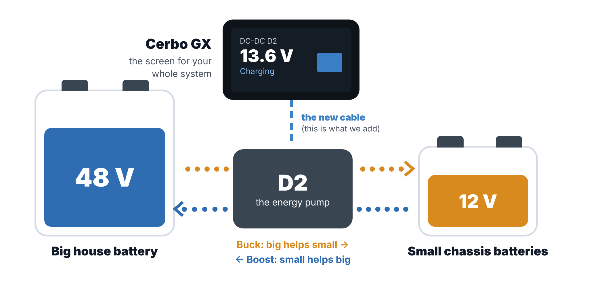

You have a **big battery** (48 V) and some **small batteries** (12 V). The **D2** sits between them and moves
energy from one to the other, like a pump between two water tanks:

- **Buck:** the big battery helps the small ones (48 V → 12 V).
- **Boost:** the small batteries help the big one (12 V → 48 V).

Your **Cerbo GX** is the screen for your whole power system. Right now it can't see the D2 at all.
**This project teaches the two of them to talk.**

## Meet the players

| | What it is | What it does |
|---|---|---|
| **Big battery** | 48 V | Your main energy store. It runs the big loads |
| **Small batteries** | 12 V | The vehicle's chassis batteries. They like about 13.5 V when charging |
| **D2** | The energy pump | Moves energy between the two. It has its own little brain and already works on its own |
| **Cerbo GX** | Victron's system screen | Shows everything, and sends it to the VRM app on your phone |
| **The cable** | A phone line | Connects the D2 to the Cerbo. You make it from a normal network cable |
| **The driver** | A translator | A small program we install on the Cerbo. It speaks the D2's language |

## What changes

| Today | After |
|---|---|
| 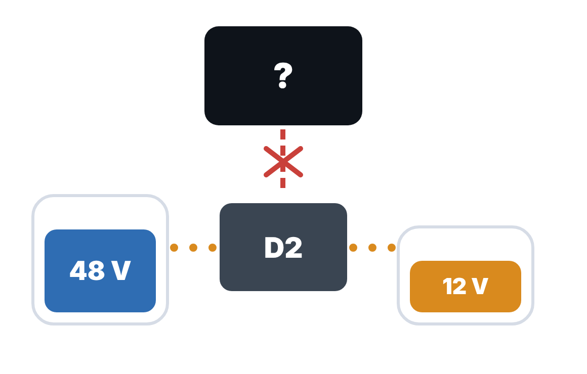 | 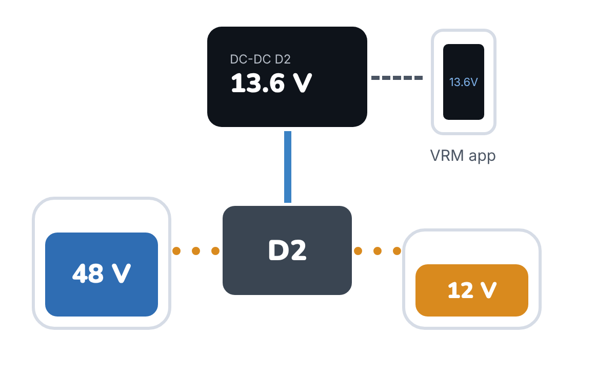 |
| The D2 does its job on its own. Nobody can see what it's doing, or tell it anything. | The Cerbo shows the D2's numbers on its screen, in the VRM app and on a web page. You can also give it orders, if you want to. |

## The phone line (the cable)

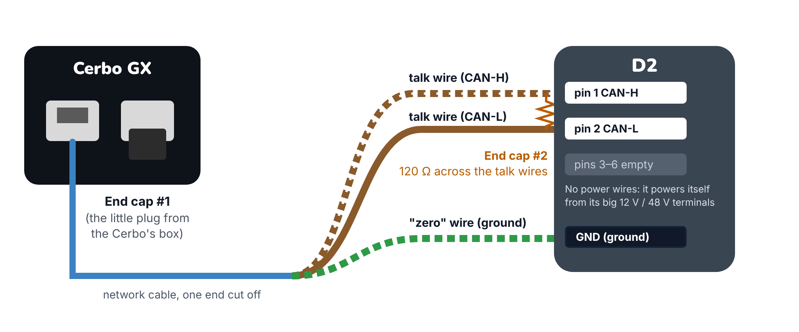

- **Two talk wires** (CAN-H and CAN-L) carry the messages. They're twisted together like a braid, which keeps out
  electrical noise.
- **The "zero" wire** (ground) makes both ends agree on what zero volts means.
- **The end caps** (120 Ω resistors) stop messages bouncing back off the ends of the line, like the foam wall at
  the end of a swimming lane. There must be exactly two: one at the Cerbo (a small plug that comes in the Cerbo's
  box) and one at the D2. The D1 had none built in and the D2's manual doesn't mention one, so you add a
  resistor there (measure first: about 60 Ω between the talk wires means both caps are in).
- **No power wires.** The older D1 needed two extra 12 V wires ("brain power" KL30 and "wake-up" KL15). The D2
  doesn't: it powers its own brain from its big 12 V or 48 V terminals. Only the two talk wires go to its plug
  (pins 1 and 2); the other four pins stay empty.

## The translator

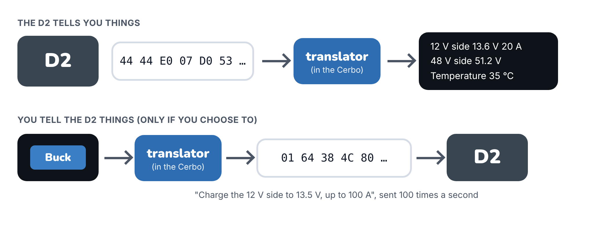

The D2 sends short coded messages about 130 times a second. For example, the eight numbers
`44 44 E0 07 D0 53 00 00` mean *12 V side 13.6 V and 20 A, 48 V side 51.2 V, temperature 35 °C*.
The Cerbo can't understand that by itself. The driver translates it, and works in the other direction too:
when you tap **Buck**, it turns that into the code the D2 understands.

## Who's driving?

| Automatic (the starting setting) | You pick by hand |
|---|---|
| 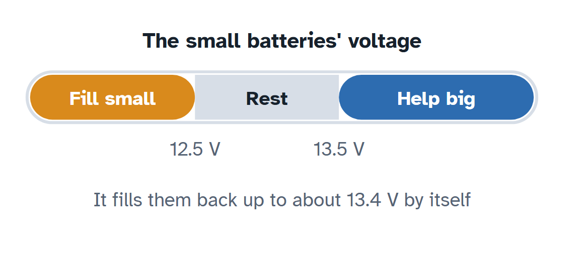 | 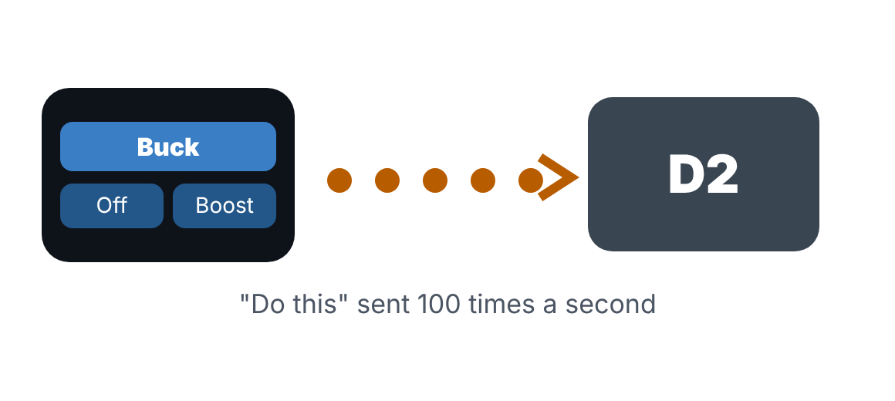 |
| The Cerbo watches the small batteries and makes **the same choice the D2 makes today**: below 12.5 V it fills them back up (to about 13.4 V), between 12.5 and 13.5 V it rests, and above 13.5 V (engine running) it helps the big battery. The difference: it also tells the D2 **how many amps it may use**, so the 12 V cable and fuse are never overloaded. Nobody has to pick buck or boost. | You pick **Off**, **Buck** (charge the small batteries to, say, 13.5 V) or **Boost**. The Cerbo then repeats that order 100 times a second. Pick **Automatic** again and the Cerbo decides by itself again. |

### The one thing nobody knows yet

If the orders suddenly stop (the Cerbo restarts, or the cable comes loose), does the D2 go back to deciding by
itself, at its full factory current? Or does it keep doing the last thing it was told? The D2's documents don't
say. That's why the [Safe Test Plan](safe-test-plan.pdf) tests this carefully, and why the Cerbo's limits are an
extra layer, not a replacement for the right fuse.

## What you'll see

| On the Cerbo screen | In the VRM app |
|---|---|
| 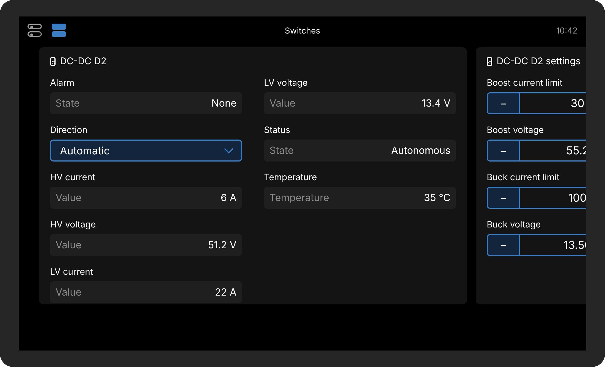 | 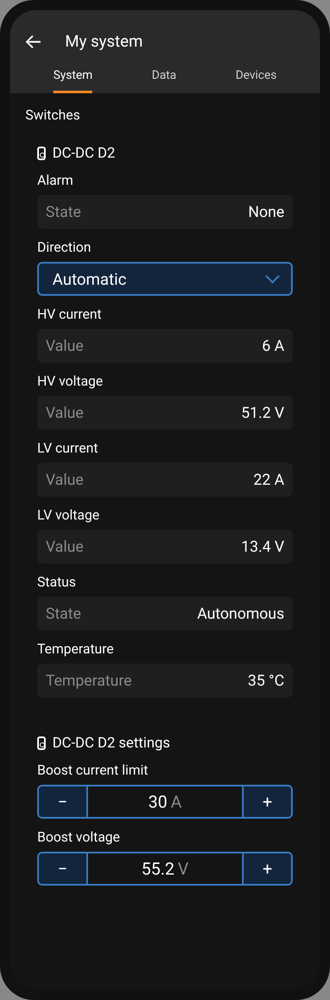 |

The **Direction** box is where you choose Automatic, Off, Buck or Boost. A second card holds the voltage targets
and current limits:

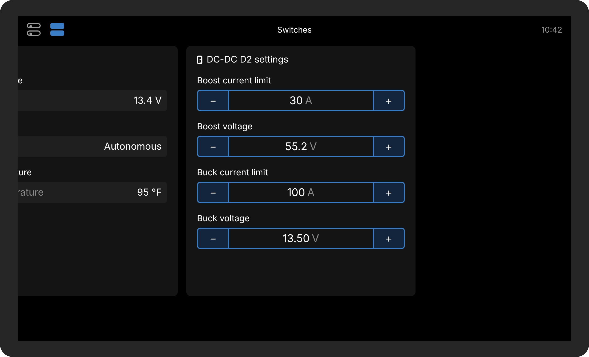

## Staying safe

Four things stop anything going badly wrong:

1. **The D2 protects itself.** It switches off if the 12 V side goes over 16–18 V, the 48 V side goes over
   58–60 V, the current goes over 213 A, or it gets too hot.
2. **Fuses and the battery's own protection.** Fuses guard the wires, and your 48 V battery's management system
   guards the battery.
3. **Your limits.** You write the highest and lowest values allowed into a settings file. The Cerbo refuses
   anything outside them, whether it comes from the screen, the phone or the web page.
4. **The big red button.** The D2 has no wake-up wire to switch off. Instead, open the fuse or breaker on its
   12 V or 48 V cable and it stops converting straight away, whatever the Cerbo is saying.

## How it's tested: like climbing stairs

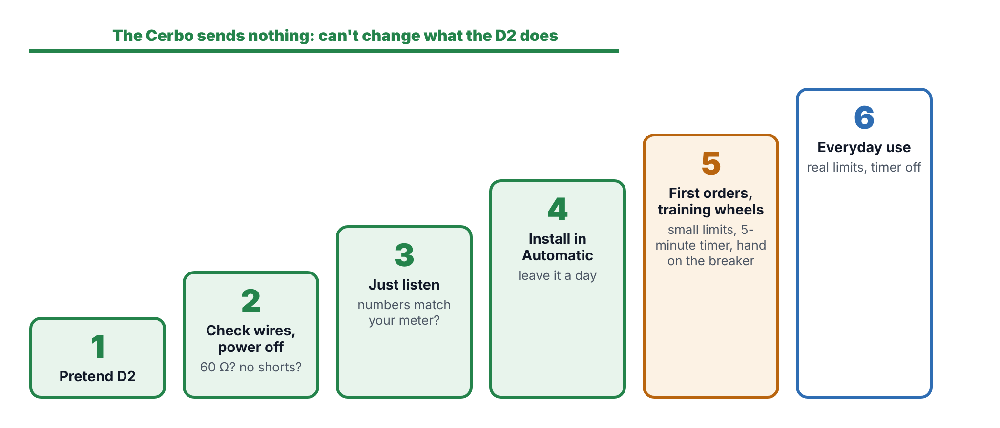

You only go up a step when the one you're on worked. On the first four steps the Cerbo sends the D2 nothing
(the plan has you set `automatic = hands_off` for them), so they can't change what it does:

1. **Pretend D2:** the real driver runs on your Cerbo against a make-believe converter. No cable, no risk.
2. **Check the wires with the power off.** About 60 Ω between the talk wires, and no shorts.
3. **Just listen.** Do the Cerbo's numbers match your meter?
4. **Install, only watching** (`automatic = hands_off`). Leave it for a day.
5. **First orders, with training wheels:** small limits, a 5-minute timer, and a hand on the breaker.
6. **Automatic with limits,** still with small limits: start and stop the engine and watch it pick buck and boost.
7. **Everyday use,** with your real limits.

The full checklist is in the [Safe Test Plan](safe-test-plan.pdf).
